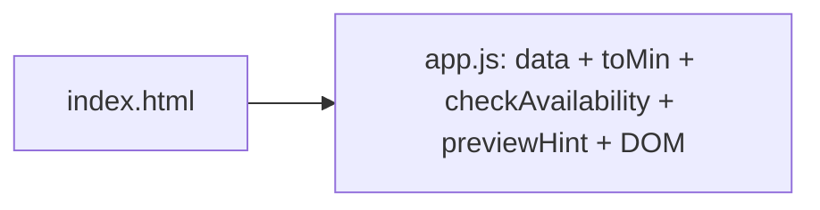
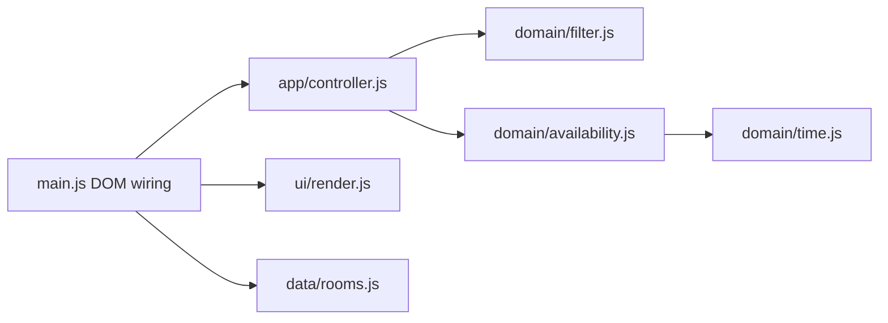

# Assignment #04 report — Smart Campus Room Checker
Student: <Surname Name> · AI assistant: Claude (Anthropic) · Date: <date>

## 1. Codebase analysis (Task 1)
Repository map given to AI: `v1_initial/app.js` (logic + data + DOM, 40 lines), `index.html`. Acceptance criteria AC1–AC6 and constraints (no login/payments/API/DB, fixed time 09:00) were pasted with it.

Maintainability risks (v1):
1. **Duplicated validation** — `checkAvailability()` and `previewHint()` in app.js contain the same two rules (time validity, 120 min); changing a rule in one silently desyncs the other.
2. **Data, rules and UI in one file** — `ROOM` constant, `toMin()`, `checkAvailability()` and DOM listeners share one scope; the code cannot be extended to many rooms or tested without a DOM guard (`typeof document`).
3. **Duplicated rendering** — the result HTML string is built separately in the click handler and in the input handler; markup/escaping changes need two edits. Also the single hard-coded `ROOM` default parameter makes "which room's bookings?" implicit — a bug risk for multi-room.

Prioritized plan: (1) baseline tests on v1 → (2) extract rules → (3) add room catalog → (4) filters → (5) single render path → (6) UI + tests.
Rejected/modified AI suggestion: <write yours, e.g. "AI proposed React + a database; rejected — violates the no-DB, minimal scope constraint; kept vanilla ES modules">.

## 2. Feature extension (Task 2)
`v2_final/src/data/rooms.js`: 5 rooms (one blocked), each with id, name, capacity, equipment, blocked, own bookings. F1–F5 implemented in `domain/filter.js` and `app/controller.js`.

## 3. Refactoring (Task 3)
Before:

After:

Design decisions: (a) **pure domain functions** (`checkAvailability(room, …)` takes the room explicitly) — guarantees the chosen room's bookings are used and makes tests DOM-free; (b) **controller returns a view-model** (`computeView`) — F4/F5 become unit-testable integration checks and `main.js` stays thin; (c) **single `renderResult`** with HTML escaping replaces two copies.

## 4. Demo scenarios (screenshots go here)
Success: attendees 30, projector+video-conf → Gamma Hall, 13:00–15:00 → *available*. Failure: no match (attendees 81) → empty state. Switch room: R101 10:00–11:00 *conflict* → R201 *available*. Blocked: Delta Meeting → *blocked*. 121 min → *invalid*.

## 5. Automated testing (Task 4)
Commands: `npm test` → **17/17 pass** for v2 (+5 v1 baseline = 22/22 total); full log `docs/test-results.txt`. Boundaries covered: 120/121 min, touching/overlapping, capacity 30 vs 31. Integration/UI: `computeView` F4/F5 and `renderResult`/`renderRoomOptions` checks.

## 6. Quality evaluation (Task 5)
| Measure | v1 | v2 | How obtained |
|---|---|---|---|
| Tests passed / total | 5/5 (AC only; F1–F5 not applicable) | 17/17 | `npm run test:v1`, `npm run test:v2` |
| Duplicated logic locations | 2 (validation, rendering) | 0 | manual code review of both versions |
| Structure | 1 file, 1 room | 7 JS modules: data, time, availability, filter, controller, render, main | file listing |
| Source lines (JS) | 40 | 83 | `wc -l` |
Remaining limitations: no real calendar/date handling, text time inputs, DOM wiring (`main.js`) not covered by automated browser tests, ad-hoc messages not localized.

## 7. AI reflection (Task 6, 200–300 words — WRITE IN YOUR OWN WORDS)
Answer: context given · useful/incorrect suggestions (e.g. first test run: v1 tests failed because of ESM/CommonJS "type" mismatch and `node --test tests/` not accepting a folder in Node 22 — fixed) · what I verified (ran tests, opened UI, read diffs) · how tests influenced decisions · next improvements.

## 8. Git references
Initial version: tag `v1-initial`. Final version: tag `v2-final`. Each change was committed separately (see `git log --oneline`). Repository URL: <insert after push>.
